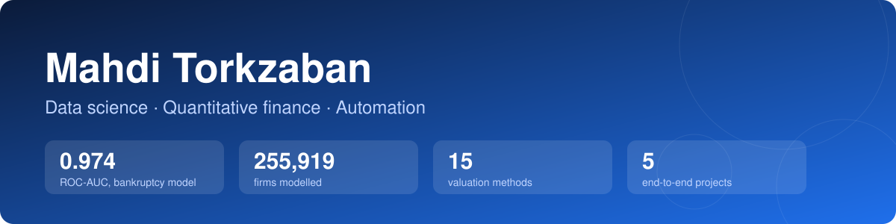

<div align="center">



<br>

Financial data analysis in Python: credit-risk machine learning on 255,919 companies, corporate valuation models and optimisation.

</div>

---

## Selected projects

| | Project | What it does | Stack |
|---|---|---|---|
| 🏦 | [**Bankruptcy Prediction**](projects/01-bankruptcy-prediction) | Predicts company failure from 3 years of financial ratios on **255,919 firms**. Final model: **ROC-AUC 0.974**, PR-AUC 0.867 on a held-out test set. 14 notebooks from feature engineering to tuned neural nets. | XGBoost · LightGBM · CatBoost · Keras · Optuna · SHAP · cuML |
| 📈 | [**Valuation Engine**](projects/02-valuation-engine) | Typed, validated engine for 15 valuation methods: FCFF/FCFE DCF, DDM, multiples, asset-based, real options, SOTP, LBO. Runnable build in [its own repo](https://github.com/mahditorkzaban/Valuation-models). | Python · dataclasses |
| 🗓️ | [**Jury Scheduling**](projects/03-jury-scheduling) | Builds oral-exam juries from teacher availability, language and priority rules, then assigns student groups while avoiding conflicts of interest. | pandas · greedy heuristics |
| 🧩 | [**Exam Scheduling**](projects/04-exam-scheduling) | Turns a resit-exam timetable into a **graph-colouring** problem so that no student has two exams at the same time. | pandas · NetworkX |
| 🤖 | [**Document Automation**](projects/05-document-automation) | Eight small tools that automate repetitive admin: OCR-based PDF splitting, clause extraction, bulk e-mail, Word batch processing. | PyMuPDF · Tesseract · SMTP |

## What I bring

- **Machine learning end to end**: feature engineering, class-imbalance handling, stratified cross-validation, threshold tuning, hyper-parameter search, model comparison.
- **Financial data analysis**: ratio analysis, DCF and relative valuation, credit-risk modelling.
- **Optimisation and automation**: turning messy operational problems into algorithms that run in seconds.
- **Languages**: Python, SQL. English, French, Persian.

## Repository layout

```
projects/
├── 01-bankruptcy-prediction/   notebooks + write-up
├── 02-valuation-engine/        single-file library with runnable demo
├── 03-jury-scheduling/         scheduling notebook
├── 04-exam-scheduling/         3-step pipeline
└── 05-document-automation/     standalone scripts
```

Each project has its own README with the problem, approach, results and how to run it. Datasets are not included (licensed or personal data); each README says what input is expected.

## Contact

📧 [mahditorkzaban5@gmail.com](mailto:mahditorkzaban5@gmail.com) · [mohammadmahdi.torkzaban@studenti.unipd.it](mailto:mohammadmahdi.torkzaban@studenti.unipd.it) · University of Padova
