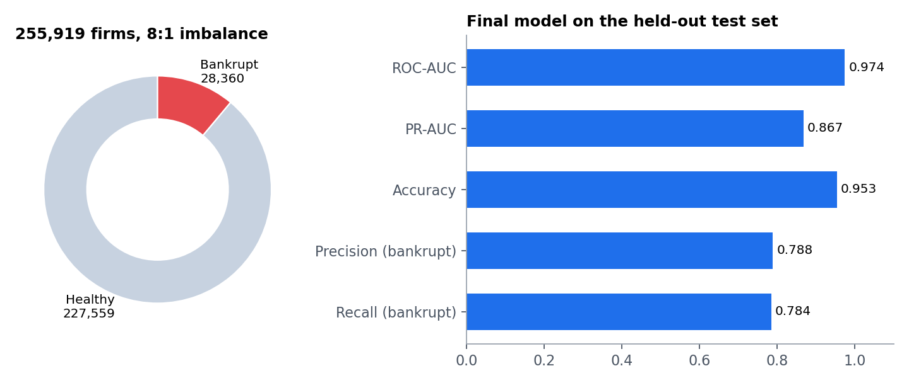
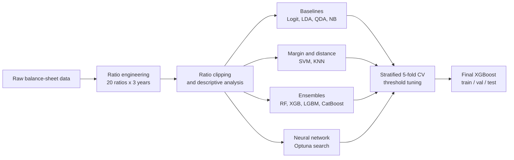
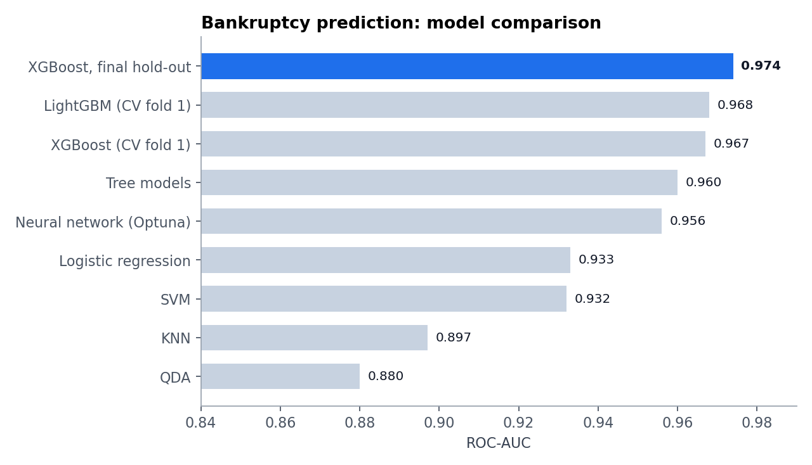

# Bankruptcy Prediction with Machine Learning

> Master's thesis project: can a company's financial statements, three years back, tell us it is about to fail?



## At a glance

| | |
|---|---|
| **Data** | 255,919 company observations from the AIDA database, 60 features |
| **Target** | Bankrupt (28,360 firms, ~11%) vs. healthy (227,559): an **8:1 imbalance** |
| **Features** | 20 financial ratios × 3 consecutive years |
| **Best model** | XGBoost, tuned on a validation set |
| **Test ROC-AUC** | **0.974** |
| **Test PR-AUC** | **0.867** |
| **Test accuracy** | 95.3%, with 78.8% precision and 78.4% recall on the bankrupt class |

Accuracy alone is misleading with 8:1 imbalance, so the evaluation focuses on **PR-AUC** and the F1 of the minority class, and the decision threshold is tuned on a separate validation split (0.799 for the final model).

## Pipeline



## Notebooks

| # | Notebook | Content |
|---|---|---|
| 01 | `feature_engineering` | Builds the 60 ratio features (profitability, structure, liquidity, solvency, activity) with safe division and ratios clipped at ±1000 |
| 02 | `descriptive_analysis` | Distributions, summary statistics, correlation heat map |
| 03 | `logit_coefficients` | Interpretable logistic-regression coefficients |
| 04 | `logreg_lda_gradient_boosting` | Linear baselines plus gradient boosting |
| 05 | `qda` | Quadratic discriminant analysis |
| 06 | `naive_bayes_kde_gpu` | Naive Bayes with kernel density estimates, GPU-accelerated (CuPy) |
| 07 | `svm_gpu` | Support vector machine on GPU (cuML) |
| 08 | `tree_models` | Decision tree, random forest, tree visualisation, feature importance |
| 09 | `xgboost_lightgbm_catboost` | The three boosted-tree libraries, 5-fold CV with per-fold threshold search |
| 10 | `knn` | K-nearest neighbours |
| 11 / 11b | `neural_network_optuna` | Keras network, Optuna hyper-parameter search, SHAP explanations |
| 12 | `resampling_and_model_comparison` | AllKNN under-sampling of the majority class, comparing the best models |
| 13 | `final_xgboost_holdout` | Production-style script: seeds, validation, early stopping, threshold selection, feature importance |

## Model comparison (stratified 5-fold CV, first fold)



| Model family | ROC-AUC |
|---|---|
| QDA | 0.880 |
| KNN | 0.897 |
| SVM | 0.932 |
| Logistic regression | 0.933 |
| Tree models (notebook 08) | 0.960 |
| Neural network (Optuna) | 0.956 |
| XGBoost / LightGBM | 0.967 / 0.968 |

Boosted trees beat everything else, which is consistent with the credit-risk literature. Logistic regression stays valuable as an interpretable benchmark.

## Run it

The notebooks were developed on Google Colab (some use a GPU). The dataset is licensed and not included; notebook 01 documents the exact input columns it expects.

```bash
pip install pandas numpy scikit-learn xgboost lightgbm catboost tensorflow optuna shap imbalanced-learn joblib
```

## Notes

Notebook outputs were cleared to keep the repository light; the numbers above come from the original runs.
