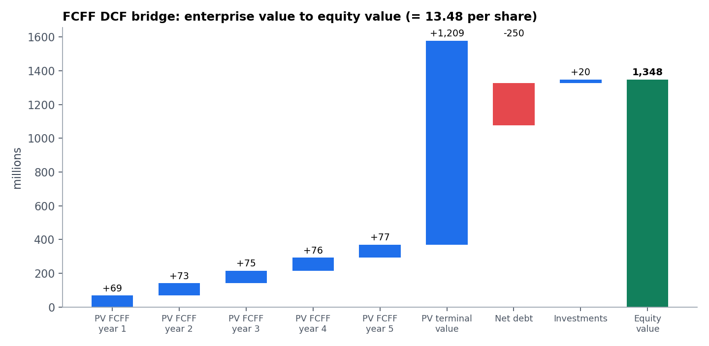

# Valuation Engine

A valuation engine covering **15 methods** behind one orchestrator, with typed, validated inputs.

> A packaged executable with JSON-driven inputs also lives in its own repo: **[mahditorkzaban/Valuation-models](https://github.com/mahditorkzaban/Valuation-models)**

```python
from valuation_engine import ValuationCalculator, FCFFInputs

calc = ValuationCalculator()
result = calc.run_fcff_dcf(FCFFInputs(
    ebit_projections=[120, 135, 150, 165, 180], tax_rate=0.25,
    da_projections=[30, 32, 34, 36, 38], capex_projections=[40, 42, 44, 46, 48],
    nwc_change_projections=[5, 5, 6, 6, 7], wacc=0.09, terminal_growth=0.025,
    net_debt=250, minority_interest=0, investments=20, diluted_shares=100))
print(result.price_per_share)   # 13.48
```

Run the built-in demo with `python valuation_engine.py` (standard library only).



*Example output: five years of discounted free cash flow to the firm plus a discounted terminal value become enterprise value, then equity value and a per-share figure.*

## Methods

| Family | Models |
|---|---|
| **Discounted cash flow** | FCFF, FCFE, Dividend Discount (Gordon and multi-stage) |
| **Relative valuation** | P/E, EV/EBITDA, EV/Sales, P/B, PEG |
| **Asset-based** | Book value, adjusted book value, liquidation value |
| **Special situations** | Black-Scholes real options, sum-of-the-parts, LBO IRR and money multiple |

## Design

- **Typed inputs and outputs**: every model has a dataclass for inputs and one for outputs, so each call is self-documenting.
- **Validation before computation**: for instance `WACC > terminal growth`, positive share count, equal-length projections. Problems come back as `warnings` on the result instead of crashing.
- **Pure, stateless models**, easy to test.

## Sanity checks

The example above was verified by hand: year-1 FCFF = 120 × (1 − 25%) + 30 − 40 − 5 = 75, discounted at a 9% WACC = 68.81. The LBO example (purchase EV 1,000, exit EV 1,500, 5 years) gives 2.88× and a 23.5% IRR.
