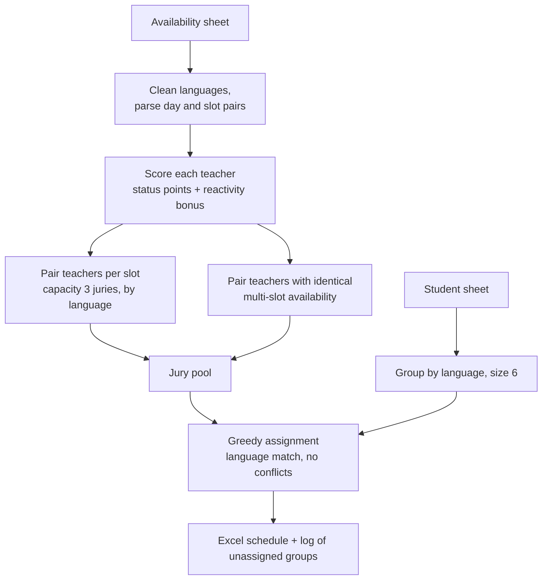

# Jury Scheduling

Builds oral-exam juries and assigns student groups to them, from raw availability spreadsheets.

## The problem

Each teacher gives free time slots per weekday, a jury language (French, English or both), and a status. Students come in groups of six with a preparing teacher. We need juries of two examiners and a slot for every group, with:

- matching language (bilingual juries only when needed),
- **no conflict of interest**: the teacher who prepared a group cannot sit on its jury,
- a fair preference for priority teachers and for those who answered early.

## Approach

1. **Scoring.** Status gives 3, 2 or 1 point; the first quarter of respondents get +1, the second quarter +0.5.
2. **Pairing.** For each slot, teachers are sorted by score and paired within their language. A second pass pairs teachers who share the same multi-slot availability.
3. **Assignment.** Groups are matched to the first free compatible slot, preferring a same-language jury over a bilingual one.
4. **Transparency.** Every decision, conflict and failure is written to a log, so a coordinator can fix the few unassigned groups by hand.

## Files

`jury_scheduler.ipynb`: the full notebook. Inputs are two Excel files (`in/`); outputs are `affectation_etudiants_jurys_par_creneaux.xlsx` and `logs_non_assignes.txt`.

## Notes

Real teacher and student data are not included, and the priority-teacher list has been redacted.
