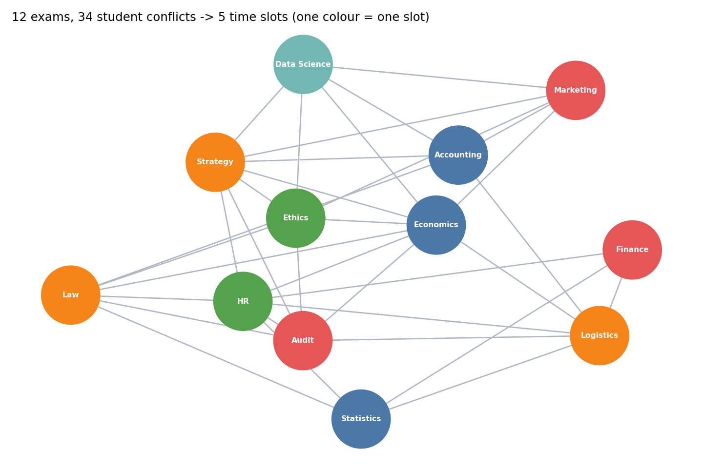

# Exam Scheduling as Graph Colouring

A resit-exam timetable where **no student may have two exams at the same time**, solved with a classic graph-theory idea.

## Idea

- Every exam is a **node**.
- Two exams are joined by an **edge** if at least one student sits both.
- Assigning a time slot = **colouring** the graph so that adjacent nodes never share a colour.
- The number of colours used is the number of parallel sessions needed.

Exams are first bucketed by duration (under 60, 60-120, 120-180, over 180 minutes), so exams of similar length run together.



*Synthetic example (`demo.py`): 12 exams and 34 student conflicts need only 5 parallel time slots. The script asserts that no two conflicting exams share a slot.*

## Pipeline

| Step | Script | What it does |
|---|---|---|
| 1 | `1_group_exams_by_duration.py` | Aggregates registrations per subject, counts students, assigns a duration group |
| 2 | `2_color_conflict_graph.py` | Builds the conflict graph per duration group and colours it with NetworkX (`largest_first` greedy strategy) |
| 3 | `3_build_schedule.py` | Collapses to a schedule: subjects per slot, number of subjects and total students |

```bash
pip install pandas networkx openpyxl
python 1_group_exams_by_duration.py && python 2_color_conflict_graph.py && python 3_build_schedule.py
```

Try the self-contained demo (no data needed): `python demo.py`.

Input is an Excel workbook with an `exam` sheet (`id`, `Subjects`, `duration`) and a `room` sheet, placed in `data/`.

## Why greedy `largest_first`

Optimal colouring is NP-hard. Colouring high-degree (most conflicted) exams first is fast, simple and typically close to optimal on timetabling graphs, and it runs in a fraction of a second for a university's resit session.
